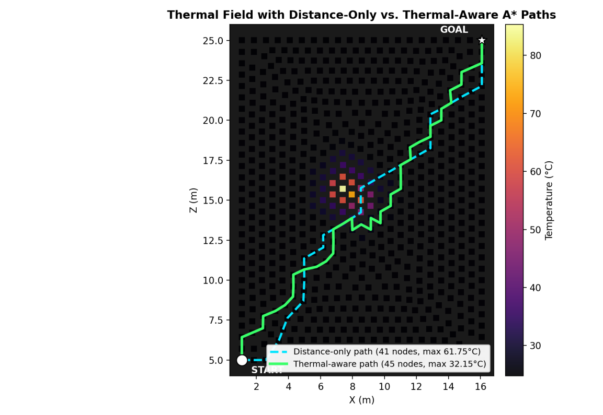
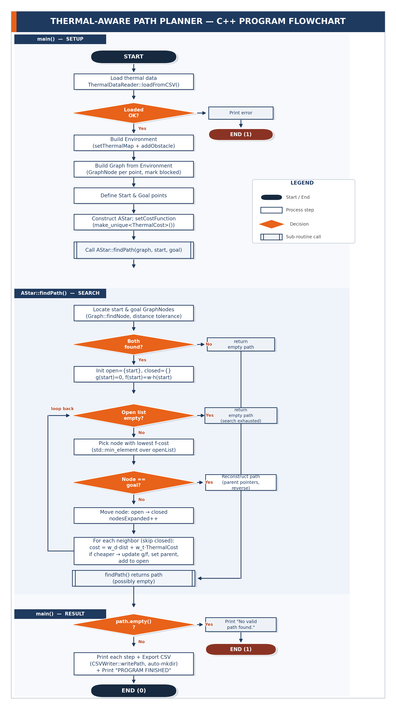
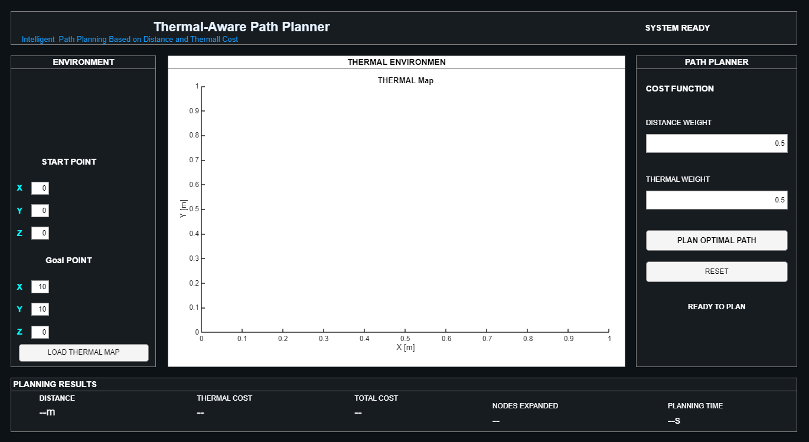
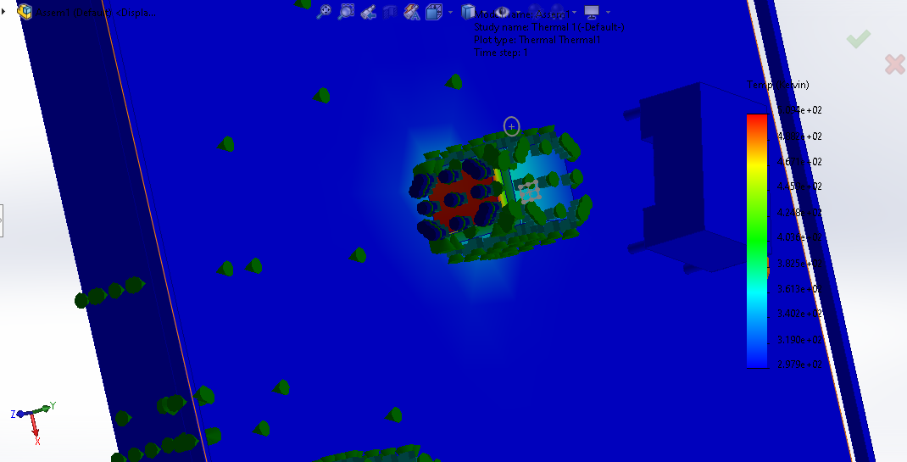

<p align="center">
  
</p>

<h1 align="center">Thermal-Aware Path Planner</h1>

<p align="center">
  An object-oriented <b>C++17</b> path planner that routes a robot around <i>heat</i> &mdash; not just around obstacles &mdash;<br>
  using real temperature data exported from a <b>SolidWorks</b> thermal simulation.
</p>

<p align="center">
  
  
  
  
</p>

---

## Why this project?

Classic path planners answer a single question: *what is the shortest collision-free route?*
Industrial sites need more. Furnaces, ovens, exhaust ducts and heavy machinery create hot zones where
**"hot" is not the same as "blocked"** &mdash; a robot that always takes the shortest path can be routed next to
equipment that slowly degrades its battery, electronics and mechanics.

This project makes A* **thermal-aware**. A small, swappable cost-function interface lets the *same* search
algorithm optimise distance, temperature, or any future criterion &mdash; without touching the search code.

## Result at a glance

Both runs use the same real dataset (673 nodes, 24.75 &ndash; 85.35 &deg;C), the same start `(1.09, 11.08, 5.00)` m
and the same goal `(16.09, 11.08, 25.00)` m.

| Strategy | Path nodes | Path length | Peak temperature | Nodes above 40 &deg;C |
|---|---:|---:|---:|---:|
| `DistanceCost` (shortest path) | 41 | 28.69 m | 61.75 &deg;C | 3 |
| `ThermalCost` (thermal-aware) | 45 | 31.88 m | **32.15 &deg;C** | **0** |

> The thermal-aware route is about 11 % longer (+3.19 m), but the hottest point along it is 29.6 &deg;C cooler,
> and it never crosses the 40 &deg;C safe threshold.



*Distance-only (dashed) vs thermal-aware (solid) path over the simulated temperature field.*
Both results were reproduced by running this repository's code with each cost function; the exported paths are in [`results/`](results/).

## Features

- **3D geometry primitives** &mdash; `Point3D` with arithmetic, comparison and stream operators.
- **Bounding-box obstacles** &mdash; axis-aligned regions the environment can test any point against.
- **Graph construction from irregular simulation meshes** &mdash; connectivity is found with a six-direction nearest-neighbour
  search instead of assuming a uniform grid.
- **Swappable cost functions** &mdash; `DistanceCost` and `ThermalCost` share one interface, so "shortest path" and "coolest path"
  differ by a single line of setup code.
- **A\* search** &mdash; open/closed lists, g/h/f costs and path reconstruction, driven by whichever cost function is installed.
- **Real SolidWorks data ingestion** &mdash; `ThermalDataReader` parses the multi-column CSV export (Kelvin &rarr; Celsius) with defensive error handling.
- **CSV path export** &mdash; `CSVWriter` saves the path and creates the output folder if it does not exist.
- **MATLAB front-end** &mdash; an App Designer GUI with its own 2D implementation of the same idea.

## Architecture



| Module (`src/`) | Classes | Responsibility |
|---|---|---|
| `Geometry` | `Point3D` | 3D coordinates, Euclidean distance, arithmetic / comparison / stream operators |
| `Thermal` | `ThermalNode`, `ThermalMap` | One temperature sample (position + &deg;C) and the collection of samples |
| `Environment` | `Obstacle`, `Environment` | Bounding-box obstacles and "is this point blocked?" queries |
| `Graph` | `GraphNode`, `Graph` | Search graph built from the thermal map; six-direction nearest-neighbour connectivity |
| `Planner` | `CostFunction`, `DistanceCost`, `ThermalCost`, `AStar` | Pluggable cost interface, its two implementations, and the A* search |
| `IO` | `ThermalDataReader`, `CSVWriter`, `CSVReader` | SolidWorks CSV ingestion, path export, and a simple whitespace-separated reader (not used by `main.cpp`) |

**Cost functions**

- `DistanceCost` &mdash; Euclidean distance between neighbouring nodes.
- `ThermalCost(thermalWeight = 5.0, safeTemperature = 40.0)` &mdash; returns `thermalWeight * max(0, T_next - T_safe)`.
  Cost grows smoothly once a node exceeds the safe temperature, so hot nodes are discouraged rather than treated as walls.
- The A* heuristic is the Euclidean distance to the goal.

`main.cpp` runs the whole pipeline in twelve explicit steps: load the thermal map, create the environment, add obstacles,
build the graph, define start/goal, create the planner, install a cost function, search, check, print, and export.

**C++ / OOP concepts demonstrated**

- Encapsulation, constructors and operator overloading (`Point3D`)
- Abstract base class with a virtual destructor (`CostFunction`)
- Runtime polymorphism through `std::unique_ptr<CostFunction>` (strategy pattern)
- Const-correctness and pass-by-const-reference
- Exception handling around CSV parsing (one bad row is reported, not fatal)
- STL containers and algorithms (`vector`, `min_element`, `find`, `reverse`), `<fstream>`, `std::filesystem`

## Getting started

### 1. C++ engine

Requires a C++17 compiler (verified with GCC 13.3). The original project file for Code::Blocks is
[`src/ThermalAwarePlanner.cbp`](src/ThermalAwarePlanner.cbp).

```bash
cd src
g++ -std=c++17 -Wall -Wextra -O2 -I. main.cpp Geometry/*.cpp Thermal/*.cpp Environment/*.cpp \
    Graph/*.cpp Planner/*.cpp IO/*.cpp -o thermal_planner
./thermal_planner        # run from src/ so that thermal_grid.csv is found
```

The path is printed to the console and exported to `src/data/path_result.csv`.

```text
========================================
        THERMAL PATH PLANNER
========================================

Loading thermal map...
Thermal data loaded successfully.
Number of thermal nodes: 673
...
Start: (1.08833, 11.0781, 5.0031)
Goal:  (16.0883, 11.0781, 25.0031)

Searching for thermal-aware path...

Path found successfully!

Path nodes: 45
----------------------------------------
Step 0 : (1.08833, 11.0781, 5.0031) | Temperature = 24.95 C
...
Step 44 : (16.0883, 11.0781, 25.0031) | Temperature = 25.05 C
----------------------------------------
```

### 2. Compare the two strategies

In step 7 of `src/main.cpp`, swap the cost function and rebuild:

```cpp
#include "Planner/DistanceCost.h"   // add this include

// thermal-aware (default)
planner.setCostFunction(std::make_unique<ThermalCost>(5.0, 40.0));

// shortest-path baseline
planner.setCostFunction(std::make_unique<DistanceCost>());
```

### 3. MATLAB application

Built with MATLAB R2024a (App Designer).

1. Open [`matlab/Thermal_Aware_planner_1.mlapp`](matlab/Thermal_Aware_planner_1.mlapp) and press **Run**.
2. **Load Thermal Map** &mdash; choose a CSV containing a 2D numeric temperature grid (read with `readmatrix`).
3. Enter the start/goal coordinates and the distance / thermal weights, then press **Plan Optimal Path**.
4. The path is drawn over the map, and the panel reports distance, thermal cost, total cost, expanded nodes and planning time.



[`matlab/localAStar.m`](matlab/localAStar.m) is a standalone 2D, 8-connected A* whose thermal penalty is the min-max normalised
temperature, `(T - Tmin) / (Tmax - Tmin)`. It is an **independent** implementation: it does not call the C++ engine and the two
cost models are not numerically interchangeable.

### 4. SolidWorks model and data



- [`solidworks/model/`](solidworks/model/) &mdash; factory-floor assembly (`Assem1.SLDASM`) with floor, walls, an industrial furnace,
  CNC machines and a work cell. File names are kept exactly as SolidWorks saved them so the assembly references stay valid.
- [`solidworks/thermal-study/`](solidworks/thermal-study/) &mdash; the "Thermal 1" Simulation study files and the raw CSV exports of the temperature results.
- [`src/thermal_grid.csv`](src/thermal_grid.csv) &mdash; the 673-node temperature field read by the C++ engine, with columns
  `Node, X_m, Y_m, Z_m, Temperature_K, Temperature_C, X_mm, Y_mm, Z_mm` (the engine uses the first five).

## Engineering notes

Every class worked in isolation, but the first end-to-end run returned "No valid path found". Three stacked integration issues were found
with small diagnostic programs and fixed:

1. **CSV column order** &mdash; the reader assumed a different column order than the real SolidWorks export; fixed by matching the true header and converting K &rarr; &deg;C.
2. **Neighbour tolerance** &mdash; a 0.01 threshold left every node without neighbours, because the measured mesh spacing is about 0.714 m; the threshold is now 1.0 m (below the next mesh "shell" at about 1.43 m).
3. **Missing output folder** &mdash; `std::ofstream` does not create directories, so the export failed silently on a clean checkout; fixed with `std::filesystem::create_directories()`.

## Known limitations and roadmap

- [ ] **Composite cost** &mdash; `ThermalCost` currently returns only the thermal penalty, so distance enters the search through the heuristic.
      A weighted `distance + thermal` cost (as `localAStar.m` already does with `distanceWeight` / `thermalWeight`) would make the objective explicit.
- [ ] **Unify the two implementations** so the C++ engine and the MATLAB app share one dataset and one cost model.
- [ ] **Scale the search** &mdash; replace the `std::vector` open list and linear closed-list scan with a `std::priority_queue` and a hash set (fine for 673 nodes, not for large maps).
- [ ] **Adaptive neighbour distance** &mdash; derive the connection threshold from the mesh instead of the fixed 1.0 m.
- [ ] **Demonstration obstacle** &mdash; place one that actually intersects the dataset (the current one does not).
- [ ] **MATLAB results panel** &mdash; report the same normalised thermal cost that the search optimises.
- [ ] **Sample 2D map** for the MATLAB app.
- [ ] **Physical deployment** on a mobile robot with live temperature sensing.

## Repository structure

```text
Thermal-Aware-Path-Planner/
├── README.md
├── assets/                      # logo, flowchart and figures
├── docs/                        # final report and presentation (PDF)
├── matlab/                      # App Designer GUI + standalone localAStar.m
├── results/                     # reference path exports for both strategies
├── solidworks/
│   ├── model/                   # parts and Assem1.SLDASM
│   └── thermal-study/           # Simulation study files and raw CSV exports
└── src/                         # C++17 engine
    ├── main.cpp
    ├── Geometry/  Thermal/  Environment/  Graph/  Planner/  IO/
    ├── data/thermal_map.csv     # small legacy demo map (not used by main.cpp)
    ├── thermal_grid.csv         # 673-node SolidWorks temperature field
    └── ThermalAwarePlanner.cbp  # Code::Blocks project
```

## Documentation

- [Final report (PDF)](docs/Thermal-Aware-Path-Planner_Final-Report.pdf)
- [Presentation (PDF)](docs/Thermal-Aware-Path-Planner_Presentation.pdf)

## About

Developed as a course project for *Computer Programming 2* (object-oriented C++), Department of Mechatronics Engineering,
Faculty of Engineering, University of Sana'a.

**Author:** Abdulmlek Al-Sharee &mdash; [@abdulmlekalsharee-create](https://github.com/abdulmlekalsharee-create)
